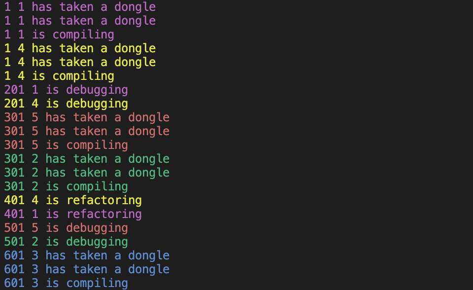
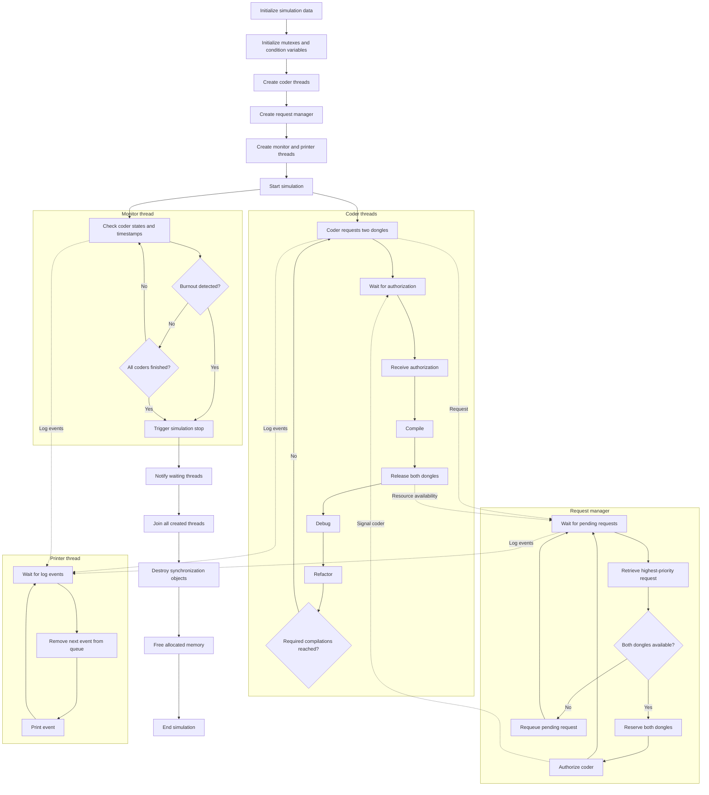
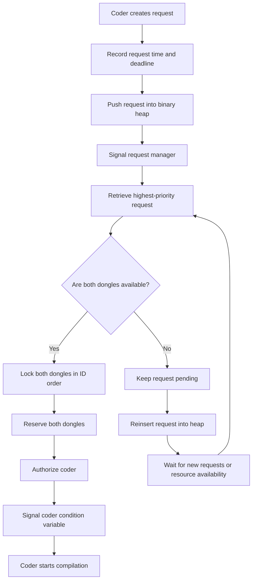

*This project has been created as part of the 42 curriculum by albben-a.*

# Codexion

<div align="center">
  <table>
    <tr>
      <td>
        
      </td>
    </tr>
  </table>
</div>


## Table of Contents

- [Description](#description)
- [Project Structure](#project-structure)
- [Instructions](#instructions)
  - [Requirements](#requirements)
  - [Compilation](#compilation)
  - [Execution](#execution)
  - [Arguments](#arguments)
  - [Example](#example)
- [Program Architecture](#program-architecture)
  - [Threads](#threads)
  - [Main Data Structures](#main-data-structures)
- [Simulation Flow](#simulation-flow)
  - [Complete Simulation](#complete-simulation)
  - [Dongle Request Management](#dongle-request-management)
- [Thread Synchronization Mechanisms](#thread-synchronization-mechanisms)
  - [Mutexes](#mutexes)
  - [Condition Variables](#condition-variables)
  - [Coder Authorization](#coder-authorization)
  - [Thread-Safe Logging](#thread-safe-logging)
- [Blocking Cases Handled](#blocking-cases-handled)
  - [Deadlocks](#deadlocks)
  - [Starvation](#starvation)
  - [Dongle Cooldown](#dongle-cooldown)
  - [Burnout](#burnout)
  - [Log Serialization](#log-serialization)
- [Resources & AI Usage](#resources--ai-usage)

---

## Description

Codexion is a concurrent programming project written in C using POSIX threads (`pthreads`).

The project simulates a group of coders sharing a limited set of dongles. Each coder must acquire two adjacent dongles before compiling. After completing a compilation, they perform debugging and refactoring tasks before requesting the dongles again.

The main challenge is coordinating multiple threads competing for shared resources while avoiding deadlocks, managing request priorities and detecting coders that exceed their allowed time without compiling.

The simulation supports two scheduling policies:

- **FIFO (First In, First Out):** requests are processed according to their arrival time.
- **EDF (Earliest Deadline First):** requests are processed according to their deadlines, calculated from the coder's last compilation start time and burnout limit.

The project focuses on thread synchronization, resource management, scheduling algorithms, race condition prevention and safe communication between concurrent threads.

## Project Structure

```text
codexion/
├── Makefile
└── coders/
    ├── initializer/
    │   ├── init_structs.c
    │   ├── init_threads.c
    │   └── initializer.c
    │
    ├── routines/
    │   ├── coder.c
    │   ├── coder_tasks.c
    │   ├── monitor.c
    │   ├── printer.c
    │   ├── req_manager.c
    │   └── req_manager_tasks.c
    │
    ├── codexion.h
    ├── main.c
    ├── parsing.c
    ├── time.c
    ├── dongles.c
    ├── heap.c
    ├── stop_simulation.c
    └── cleanup.c
```

### Main components

| Component | Responsibility |
|---|---|
| `main.c` | Entry point and simulation orchestration. |
| `parsing.c` | Validates and converts command-line arguments. |
| `initializer/` | Initializes shared structures, synchronization objects and threads. |
| `routines/coder.c` | Implements the main routine executed by each coder thread. |
| `routines/coder_tasks.c` | Handles compilation, debugging and refactoring tasks. |
| `routines/req_manager.c` | Manages requests for dongles. |
| `routines/req_manager_tasks.c` | Implements request processing and authorization logic. |
| `routines/monitor.c` | Checks burnout conditions and simulation completion. |
| `routines/printer.c` | Processes and prints queued log events. |
| `heap.c` | Implements the binary heap used to prioritize requests. |
| `dongles.c` | Handles dongle acquisition, release and cooldown. |
| `time.c` | Provides time-related utilities. |
| `stop_simulation.c` | Coordinates simulation shutdown. |
| `cleanup.c` | Releases allocated memory and destroys synchronization objects. |
| `codexion.h` | Shared structures, declarations and definitions. |

## Instructions

### Requirements

The project requires:

- A C compiler (`cc`).
- POSIX threads support (`pthread`).
- GNU Make.
- A Unix-like environment.

### Compilation

Clone the repository and navigate to the project directory.

Compile the project using:

```bash
make
```

The Makefile provides the following rules:

| Command | Description |
|---|---|
| `make` | Compiles the project. |
| `make clean` | Removes object files. |
| `make fclean` | Removes object files and the executable. |
| `make re` | Performs a complete rebuild. |

The compilation uses the following flags:

```bash
-Wall -Wextra -Werror -pthread
```

The resulting executable is named `codexion`.

### Execution

Run the program using the following syntax:

```bash
./codexion number_of_coders time_to_burnout time_to_compile time_to_debug time_to_refactor number_of_compiles_required dongle_cooldown scheduler
```

### Arguments

The program expects exactly eight arguments:

| Argument | Description |
|---|---|
| `number_of_coders` | Number of coders participating in the simulation. |
| `time_to_burnout` | Maximum time a coder can go without starting a new compilation before burning out. |
| `time_to_compile` | Time required to complete a compilation task. |
| `time_to_debug` | Time required to complete a debugging task. |
| `time_to_refactor` | Time required to complete a refactoring task. |
| `number_of_compiles_required` | Number of successful compilations each coder must complete before the simulation can finish. |
| `dongle_cooldown` | Time a dongle remains unavailable after being released. |
| `scheduler` | Scheduling policy used to prioritize requests: `fifo` or `edf`. |

All numeric arguments must contain digits only. The number of coders cannot be zero.

The scheduler argument must be one of the following:

- `fifo`
- `edf`

### Example

```bash
./codexion 3 2000 200 200 200 2 50 edf
```

This command starts a simulation with:

- 3 coders.
- A burnout limit of 2000 ms.
- 200 ms per compilation.
- 200 ms per debugging task.
- 200 ms per refactoring task.
- 2 required compilations per coder.
- A dongle cooldown of 50 ms.
- EDF request scheduling.

A possible output sequence is:

```text
0 1 has taken a dongle
0 1 has taken a dongle
0 1 is compiling
201 1 is debugging
402 1 is refactoring
405 2 has taken a dongle
405 2 has taken a dongle
405 2 is compiling
605 2 is debugging
806 2 is refactoring
```

The timestamps and event ordering are illustrative. Actual output depends on thread scheduling and resource availability.

---

## Program Architecture

The simulation is organized around several cooperating threads that share a common data structure.

Each coder has its own thread, while a dedicated request manager coordinates access to dongles. A monitor checks the simulation state, and a printer thread handles output.

### Threads

| Thread | Responsibility |
|---|---|
| Coder threads | Execute the compilation, debugging and refactoring cycle. |
| Request manager | Processes pending requests and grants access to dongles according to the selected scheduling policy. |
| Monitor | Detects burnout conditions and checks whether all coders have completed their required compilations. |
| Printer | Processes the log queue and prints events sequentially. |

The main thread initializes the simulation, creates the required threads, waits for their completion and performs cleanup.

### Main Data Structures

The project uses several structures to manage shared state and coordinate the threads.

| Structure | Purpose |
|---|---|
| `t_data` | Stores global simulation data, shared resources, thread information and initialization counters. |
| `t_coder` | Stores each coder's ID, compilation count, last compilation start time, thread, condition variable and authorization state. |
| `t_dongle` | Represents a dongle, including its ID, availability state, cooldown timestamp and mutex. |
| `t_request` | Stores a pending request, its associated coder, request timestamp and deadline. |
| `t_heap` | Stores pending requests in a binary heap and contains the selected scheduling policy and synchronization objects. |
| `t_log_queue` | Stores log events in a linked queue protected by a mutex and condition variable. |

The binary heap allows the request manager to retrieve the highest-priority request efficiently.

Its priority depends on the selected scheduler:

- FIFO compares request timestamps.
- EDF compares request deadlines.

Both insertion and removal operations have a time complexity of **O(log n)**.

---

## Simulation Flow

The simulation follows a request-and-authorization model. Coder threads do not acquire dongles independently. Instead, they submit requests to a shared priority queue and wait until the request manager authorizes them.

This centralizes resource allocation and allows the program to apply different scheduling policies while coordinating access to shared resources.

### Complete Simulation

The following diagram shows the overall lifecycle of the simulation, from initialization to shutdown, including the interaction between coder threads, the request manager, the monitor and the printer.



The main execution cycle is repeated independently by each coder. The request manager coordinates access to dongles, while the monitor and printer operate concurrently with the simulation.

The simulation stops when a burnout is detected or when all coders have completed the required number of compilations. Waiting threads are notified so they can terminate before the main thread performs cleanup.

### Dongle Request Management

The request manager is responsible for processing requests and granting access to the two dongles required by each coder.



Each request contains:

- The requesting coder.
- The request timestamp.
- The request deadline, calculated using the coder's last compilation start time and burnout limit.

The binary heap orders requests according to the selected scheduling policy. When a request is processed, the manager checks whether both required dongles are available and whether their cooldown periods have expired.

If both can be reserved, they are marked as in use and the coder is authorized. Otherwise, the request is reinserted into the heap to be considered again.

---

## Thread Synchronization Mechanisms

Since multiple threads access shared resources, synchronization is essential to prevent race conditions and inconsistent states.

The project uses POSIX mutexes and condition variables to coordinate access to shared data and communicate between concurrent threads.

### Mutexes

Mutexes protect shared resources and ensure that only one thread can modify a protected structure at a time.

They are used for:

- **Dongles:** protect availability states and cooldown timestamps.
- **Request heap:** protect insertion, removal and access to pending requests.
- **Coder data:** protect authorization states, compilation counters and last compilation timestamps.
- **Log queue:** protect insertion, removal and queue state.
- **Shared simulation state:** coordinate access to data that must remain consistent.

When a coder needs two dongles, their mutexes are locked in ascending dongle ID order.

Both dongles are checked and reserved while their mutexes are held. This prevents another thread from modifying their state during the reservation process and avoids circular wait between threads attempting to acquire dongles.

### Condition Variables

Condition variables allow threads to wait until a specific event occurs instead of continuously checking a condition.

They are used to coordinate:

- Coders waiting for authorization.
- The request manager waiting for new requests or resource availability.
- The printer waiting for new log events.

Condition variables are used together with mutexes. Waiting threads recheck the relevant condition after waking up, since a signal does not necessarily mean that the requested resource is available.

### Coder Authorization

Each coder has an authorization state and a dedicated condition variable.

The request manager updates the authorization state and signals the corresponding coder when both dongles have been reserved.

The coder waits until it receives authorization, consumes that authorization and proceeds with compilation.

During shutdown, waiting coders receive a cancellation state and are notified so they do not remain blocked indefinitely.

### Thread-Safe Logging

Logging is handled by a dedicated printer thread.

Other threads do not print events directly. Instead, they create log entries and append them to a shared queue.

The queue is protected by a mutex, while a condition variable notifies the printer when new events are available.

This ensures that only one thread writes simulation output at a time, preventing interleaved log messages and keeping printing operations separate from the main simulation logic.

---

## Blocking Cases Handled

The project addresses several synchronization problems that can occur when multiple threads compete for limited resources.

### Deadlocks

A deadlock can occur when multiple threads hold resources while waiting indefinitely for resources held by one another.

The four Coffman conditions are:

1. **Mutual exclusion:** a resource can only be used by one thread at a time.
2. **Hold and wait:** a thread holds resources while waiting for additional ones.
3. **No preemption:** resources cannot be forcibly taken away from a thread.
4. **Circular wait:** threads form a circular chain of resource dependencies.

The project prevents circular wait during dongle acquisition by locking both dongle mutexes in ascending ID order.

Both dongles are checked and reserved while their mutexes are held. This avoids a situation in which a coder acquires one dongle and waits indefinitely for the other.

### Starvation

Starvation occurs when a thread repeatedly fails to obtain the resources it needs because other threads are continually prioritized.

The request manager uses a priority queue to establish a defined request order:

- FIFO prioritizes older requests.
- EDF prioritizes requests with earlier deadlines.

These policies provide explicit arbitration between competing requests. However, they do not constitute an unconditional mathematical guarantee against starvation under every possible simulation configuration.

### Dongle Cooldown

After a compilation, both dongles are released and assigned an `available_at` timestamp.

A dongle can only be reserved when:

- It is not currently in use.
- Its cooldown timestamp has been reached.

The request manager checks both conditions before granting a request.

This prevents a coder from using a dongle before its cooldown period has elapsed.

### Burnout

A coder burns out when it exceeds the configured time limit without starting another compilation.

The monitor periodically checks each coder's last compilation start timestamp.

If the elapsed time reaches the burnout limit and the coder has not finished its required compilations, the monitor:

1. Logs the burnout event.
2. Sets the simulation stop state.
3. Notifies the request manager and waiting threads.
4. Initiates the shutdown process.

The monitor checks at short intervals, although actual detection timing can be affected by operating-system thread scheduling.

### Log Serialization

Multiple threads can generate events at nearly the same time.

To prevent output from becoming mixed or corrupted, all log events are inserted into a synchronized queue and processed by a single printer thread.

This guarantees serialized output and keeps logging operations thread-safe.

---

## Resources & AI Usage

### Resources

- [POSIX Threads Programming](https://www.infor.uva.es/~fdiaz/aso/2005_06/doc/ASO_PR01_20060228) — Reference material on POSIX thread programming.
- [The Open Group — pthreads](https://pubs.opengroup.org/onlinepubs/9699919799/basedefs/pthread.h.html) — POSIX thread interfaces and synchronization primitives.
- [GNU C Library Documentation](https://www.gnu.org/software/libc/manual/) — C library and threading-related documentation.
- [GeeksforGeeks — Binary Heap](https://www.geeksforgeeks.org/binary-heap/) — Reference for binary heap concepts and priority queue operations.

### AI Usage

AI tools were used as a support resource during the development and documentation process.

The main uses were:
- Technical Explanations: Clarifying concepts related to POSIX threads, mutexes, condition variables and concurrent resource management.
- Concurrency Analysis: Exploring possible race conditions, deadlocks, starvation scenarios and synchronization strategies.
- Testing Support: Helping identify useful edge cases and scenarios for checking scheduling and resource allocation behaviour.

The final design decisions and code were checked and tested to ensure that the implementation was understood and could be explained independently.